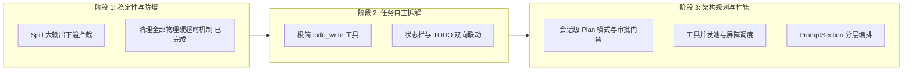

# 基于 DeepSeek Harness 的 Agent 架构演进与改造路线图

本文档对照 [DeepSeek Harness](https://github.com/deepseek-ai/deepseek-harness)（DeepSeek 官方开源的 Agent Harness，基于 Cordis 微内核架构）的核心设计，系统梳理当前 Dusk 项目在任务调度、工具流水线、状态治理与规划协同方面的技术差距，并制定具体的架构改造方案。

---

## 一、 整体架构全景对照

| 架构维度 | Dusk 现状 | DeepSeek Harness 参照 | 核心技术收益 |
| :--- | :--- | :--- | :--- |
| **超大文本处理** | 工具输出直接推入上下文，易撑爆 Token | **Spill 存储下溢**（文本存盘，只给模型定位符） | 彻底消除大输出导致的上下文截断和 OOM |
| **任务规划推进** | 宿主单向维护状态，模型无法自主打勾 | **极简 `todo_write` 工具**（整表快照替换） | 模型可自主建立待办清单，驱动复杂任务分步落地 |
| **架构设计与思考** | 仅依赖单轮意图分类，无硬性流程约束 | **会话级 `plan-mode` 状态机 + 审批门禁** | 强制“先探索、出方案、经批准后执行”，拒绝盲目改代码 |
| **工具执行调度** | 工具完全串行分派执行 | **并发池 + 独占屏障（Concurrency Barrier）** | 读操作并行化，代码搜索与文件阅读速度提升 3~5 倍 |
| **提示词编排** | 字符串硬拼接，易破坏前缀缓存 | **有序 `PromptSection` 组装器** | 提示词模块化管理，最大化 KV Cache 命中率 |
| **上下文数据源** | 数据库表直接组装，与渲染高度耦合 | **“模型所见即日志”（Event-Sourced Log）** | 完整支持会话重放、确定性恢复与状态分叉 |

---

## 二、 五大核心改造方案详解

### 1. 工具执行输出 Spill（下溢存盘）机制 【P0】

#### 痛点背景
在执行 `git diff`、大文件阅读、单元测试输出或依赖安装时，单次工具调用的返回文本动辄数千行，极易直接打满模型的上下文窗口，触发非预期的压缩或截断。

#### Harness 参照设计 (`packages/spill`)
- 设立大输出拦截中间件，设定阈值（如大于 30KB 或 1500 行）；
- 超过阈值时，自动将内容落盘为产物文件（例如 `.dusk/spills/tool_name_xxx.txt`）；
- 仅向模型返回**精简预览（前 30 行 + 后 20 行）+ 统计指标（总字符/总行数）+ 定位句柄（Spill Locator）**；
- 附带检索引导提示词：*“完整输出已存入产物文件，如需按行阅读或检索关键字，请调用 `read_file`（配合起止行）或 `grep_search` 查看”*。

#### Dusk 落地路径
1. 新建 `src/agent/spill/spill-store.ts`，管理会话级溢出文本产物；
2. 在 `src/agent/runner.ts` 的 `attempt()` 工具执行包装器中挂载拦截器；
3. 输出超过阈值时自动落盘并替换返回给模型的 `toolResult.content`。

---

### 2. 极简 `todo_write` 工具与状态栏深度联动 【P0】

#### 痛点背景
当前 Dusk 已落地由代码维护的任务状态栏，但其中的待办计划高度依赖宿主预先解析的验收合同。当处理没有显式验收项的通用开发任务时，模型缺乏一个在上下文中“随时写下待办清单、标记当前项、打勾完成项”的自主工具。

#### Harness 参照设计 (`packages/todo/tool-todo`)
- **极简数据协议**：不引入复杂 ID、依赖关系与优先级，仅保留极简结构：
  ```typescript
  interface TodoItem {
    content: string; // 简要动作说明
    status: 'pending' | 'in_progress' | 'completed';
  }
  ```
- **整表快照替换（Wholesale Replacement）**：模型每次调用 `todo_write({ todos: TodoItem[] })`，以最后写入为准覆盖旧清单。

#### Dusk 落地路径
1. 实现 `src/agent/tools/todo/todo-tool.ts`，暴露 `todo_write` 给模型；
2. 在工具执行回调中，将传入的 `todos` 同步写入 `TaskStatusBarTracker` 的内部状态；
3. 状态栏在下一轮请求注入时，自动将模型最新的 TODO 清单渲染到上下文尾部：
   ```text
   • 进度计划 (TODO List):
     [x] 1. 分析当前状态栏架构 (completed)
     [>] 2. 编写 todo_write 工具实现 (in_progress)
     [ ] 3. 验证端到端执行流 (pending)
   ```

---

### 3. 会话级 Plan 模式与交互式审批门禁 【P1】

#### 痛点背景
对于复杂重构或大项目，模型经常在尚未摸清整体代码架构的情况下立即动手乱改，改完报错又瞎猜，陷入恶性循环。

#### Harness 参照设计 (`packages/plan/plan-mode`)
- **会话协作状态机**：通过命令 `/plan` 进入计划模式，在会话生命周期中持续生效，而非仅作为单轮意图；
- **只读沙箱策略（Policy Section）**：计划模式激活期间，提示词强行注入规范：“*当前处于计划模式，严禁调用修改代码、创建文件或破坏性命令工具，只能进行代码阅读、依赖分析和方案设计*”；
- **渐进披露 `exit_plan_mode`**：
  - 只有进入计划模式后，才向模型开放 `exit_plan_mode(planMarkdown)` 工具；
  - 模型制定完架构方案后调用该工具，向前端 UI 触发审批交互；
  - 用户审阅并点击“批准”后，系统自动切换为执行模式，解除写操作锁定；若用户点击“继续规划并附带建议”，工具返回用户反馈，模型继续优化计划。

#### Dusk 落地路径
1. 扩展会话状态，新增 `planMode: { active: boolean }`；
2. 在 `TurnControl` 中将计划模式提升为长程状态；
3. 新增 `exit_plan_mode` 工具，并在其执行时拦截触发 `onAskPermission` 或审批事件流。

---

### 4. 工具并发池与独占屏障（Concurrency Barrier） 【P1】

#### 痛点背景
当前 Dusk 的工具调用为纯串行分派，当模型一次性发出 5 个读文件请求时，需要依次等待 5 次 I/O，严重拖慢前期代码探索阶段的速度。

#### Harness 参照设计 (`packages/core/tools`)
- **无副作用分类器**：
  ```typescript
  isConcurrencySafe(toolName: string, args: unknown): boolean
  ```
  - `read_file`、`list_files`、`grep_search`、`git_status` 判定为并发安全（Concurrent-Safe）；
  - `write_file`、`replace_file_content`、`execute_command` 判定为独占操作（Exclusive）。
- **调度流水线**：连续的并发安全操作被推入并发池，使用 `Promise.all` 并行加速；一旦命中独占工具，则形成执行屏障（Barrier），等待前序读操作全部完成后，排他执行写操作。

#### Dusk 落地路径
1. 在 `src/agent/tools/registry.ts` 中为工具注册元数据添加 `isConcurrencySafe` 属性；
2. 改造 `src/agent/runner.ts` 中的批次执行调度逻辑，从单线程 `for` 循环改为按屏障分组的并发调度器。

---

### 5. 系统提示词分层组装 DSL（System Prompt Assembly） 【P2】

#### 痛点背景
Dusk 目前的 `systemPrompt` 由各模块以字符串硬拼接方式拼装，结构散碎，且任意细微变动（如时钟、临时状态）都会导致最前端的 Prompt 发生变动，直接破坏供应商的 KV Cache。

#### Harness 参照设计 (`packages/core/system-prompt`)
- **规范化 `PromptSection` 体系**：
  每个提示词片段具备全局唯一名称与数字权重（Order）：
  - `order: 10` -> 人设基座（Persona Prefix）
  - `order: 30` -> 平台与静态环境（永久缓存）
  - `order: 50` -> 模式策略（如 Plan Mode Policy）
  - `order: 80` -> 工具与技能规范（Skills）
  - `order: 100` -> 动态边界与安全约束
- **动静解耦**：静态段落固定在 Prompt 头部保持 100% 缓存命中；易变的运行时状态栏与动态控制信息固定挂载于尾部（Tail Injection）。

#### Dusk 落地路径
1. 重构 `src/agent/prompt.ts`，引入 `PromptAssembler` 聚合器；
2. 统一管理各类 Skill、验收规范与边界声明的优先级。

---

## 三、 推荐实施节奏



1. **第一优先级（ROI 最高，快速防爆）**：
   - 落地 **工具 Spill 机制**：解决长会话和复杂任务中的 Token 溢出暴毙；
2. **第二优先级（交互体验倍增）**：
   - 落地 **`todo_write` 工具**：结合当前的状态栏，让 Agent 在执行多步开发时有清晰的自我节奏感；
3. **第三优先级（系统级进阶）**：
   - 引入 **Plan 计划模式** 与 **并发工具执行**。
